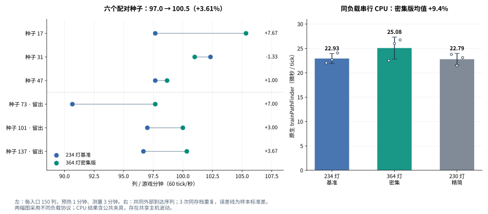
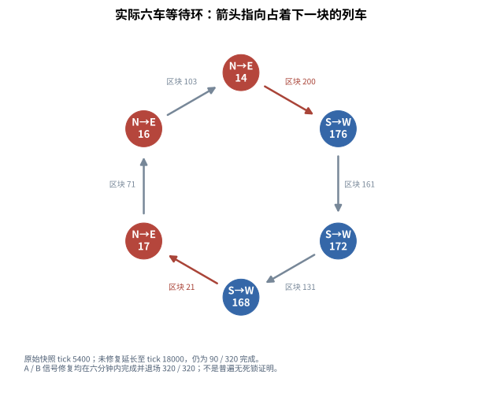
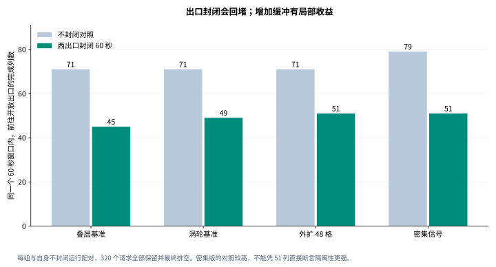

# 铁路优化第三轮：拓扑、信号组合与入口队首阻塞

## 1. 这轮得到的改进

**推荐继续保留“涡轮二型·364 灯密集版”作为吞吐优先候选。** 在每个入口持续有待发列车的六个配对种子中，有限饱和放行的平均吞吐由 **97.00 提高到 100.50 列/游戏分钟（+3.61%）**。它与 234 灯基准的轨道、坡道、支撑完全相同，包围盒面积均为 **17,417.81 格²**。新增 130 盏有效信号使原生区块数从 227 增至 356；完整建造、信号 working 与 12 OD 检查通过。

代价是计算开销。本批串行计时中，原生寻路均值 **22.93 → 25.08 微秒/tick（+9.4%）**，重复测量存在波动。它体现同占地的小幅吞吐收益，不能称为 CPU 优化。进入三种子长窗复验的 SW32、outer48 和 loop32 均未超过涡轮基准；其余几何候选仅完成短筛。没有证据宣布全局最优。

本轮完成 **39 个新的合法候选配置**：信号组合 20、入口/局部缓冲 7、连续高架与信号组合 6、延后出口合流 4、死锁后的连锁信号修复 2。另有 **29 个构造草案**未通过建造门槛，以及 7 个命名对照或无变化别名，均不计入新候选。39 个合法候选中有 1 个并发死锁失败案例。“能建造、能单车通行”与“并发安全”分开记录。

实验索引包含 **94 个已完成 bank/出口封闭流量案例**、12 个同需求组；此外有独立建造/路径审计、四出口排空验收及 9 次正式 CPU 计时。索引不把它们混成同一种实验计数。数据汇总见 [results-summary.json](results-summary.json)，完整逐车证据见研究包中的 `round3/results-index.json`。



## 2. 固定约束与测量口径

使用 **Factorio Headless 2.1.25，build 88022**，启用 base、quality、elevated-rails、space-age，并自动启用依赖 recycler。这里只报告固定版本，不称其为当前最新版。

- 四个方向各一条驶入、一条驶出单向轨道，共 8 个外部端口；右侧行车，不扩成四轨/六轨外部主干。
- 列车为 1 机车 + 4 节普通品质、空载货厢，核燃料，制动力科技 1–7；12 条非掉头 OD，主比较为 S1 等概率转向。
- 游戏原生物理、寻路、信号、轨道碰撞与预约；不直接写速度、不传送列车。外部每入口 FIFO，不跳过堵住的请求，不丢弃未发需求。
- 内部可分流、合流、设置缓冲或使用高架。面积为原生实体变换后包围盒的总外接矩形，含高架的投影，排除公共进出线夹具。它不是轨道覆盖面积并集，也不是材料成本。
- 短筛：每入口 80 列，预热 1,800 tick，测量 3,600 tick。较长比较：每入口 150 列，预热 3,600 tick，测量 10,800 tick。按 60 tick/游戏秒换算，不以墙钟时间计算吞吐。
- 首个公共出口信号距接口 8 格；列车所有车厢中心越过固定完成边界才计完成，远端另行回收。外部线路、燃料与车站条件保持一致。

为了给搜索节省运行时间，仅优化了观察脚本的句柄缓存与计数方式。三个对照共 960 条逐车记录，以及采样、时刻、位置、速度、状态完全相等；最终快照只忽略游戏分配的轨道内部编号。原生动作未改变。证据为 `round3/protocol/equivalence.json`。

**关键修正：有限饱和放行率不等于最大稳定容量。** 短窗 110 列/分钟是筛选结果，不能当长期容量。bank 从 80 增至 150 还会改变原顺序随机数发生器的 E/S/W 需求序列，所以两种 bank 不能当作同一序列单纯延长。公平比较限定为同 bank、同 seed、同窗口与同 OD 记录。

## 3. 吞吐复核：较长窗口和独立留出

### 3.1 全部九个较长比较配置

下表全部使用种子 17、31、47，预热 1 分钟后测量 3 分钟；单位为列/游戏分钟。每个方向的外部车列在窗口内均未耗尽，12 OD 均获得服务，损伤事件为零。

| 配置 | 种子 17 | 种子 31 | 种子 47 | 均值 | 信号数 | 包围盒面积 |
| --- | --- | --- | --- | --- | --- | --- |
| 涡轮二型·364 灯密集版 | 105.33 | 101.00 | 98.67 | 101.67 | 364 | 17,417.8 |
| 涡轮二型·234 灯基准 | 97.67 | 102.33 | 97.67 | 99.22 | 234 | 17,417.8 |
| 涡轮二型·230 灯局部精简 | 96.33 | 102.67 | 97.67 | 98.89 | 230 | 17,417.8 |
| 涡轮二型·反向布灯 | 98.00 | 101.33 | 91.67 | 97.00 | 246 | 17,417.8 |
| 叠层·合流连锁信号 | 95.67 | 93.00 | 93.00 | 93.89 | 169 | 13,263.6 |
| 叠层苜蓿叶·169 灯基准 | 91.67 | 97.67 | 92.00 | 93.78 | 169 | 13,263.6 |
| 叠层·回环 32 格缓冲 | 85.67 | 94.67 | 97.67 | 92.67 | 248 | 19,790.1 |
| 叠层·外扩 48 格缓冲 | 87.33 | 96.67 | 92.67 | 92.22 | 265 | 23,053.3 |
| 涡轮·西南出口延后合流 32 格 | 87.00 | 96.67 | 81.33 | 88.33 | 256 | 21,641.1 |

密集版在这组三种子由 99.22 升到 101.67（+2.46%），幅度不大，因此在查看新结果前固定了留出种子 73、101、137，全部跑完、不换种子、不择优停止。相应预先计划在 `round3/holdout-plan.json`。

### 3.2 六个配对种子的完整结果

| 种子 | 阶段 | 234 灯基准 | 364 灯密集版 | 差值 |
| --- | --- | --- | --- | --- |
| 17 | 原比较 | 97.67 | 105.33 | +7.67 |
| 31 | 原比较 | 102.33 | 101.00 | -1.33 |
| 47 | 原比较 | 97.67 | 98.67 | +1.00 |
| 73 | 预先指定的留出 | 90.67 | 97.67 | +7.00 |
| 101 | 预先指定的留出 | 97.00 | 100.00 | +3.00 |
| 137 | 预先指定的留出 | 96.67 | 100.33 | +3.67 |
| 六种子均值 | 同协议 | 97.00 | 100.50 | +3.50 |

新增三种子中，基准平均 94.78、密集版 99.33，三个配对均改善；六种子总体 5 胜 1 负。种子 31 下降 1.33，因此不能宣称每一种到达序列都更好，也不将小样本结果称为统计显著或全局最优。

230 灯局部精简版比 234 灯基准少 4 盏，三种子均值 98.89 对 99.22；叠层合流连锁版均值 93.89 对 93.78，只多 1 列/累计 9 分钟。两者均不足以作为新的性能突破。完整原始长窗结果来自 `long-signal.json`、`long-dense.json`、`long-loop.json`、各方向的 `local-long.json` / `long-outer48.json` / `long-sw32.json` 等，路径与哈希列于汇总文件。

## 4. 信号搜索与原生 CPU

搜索包括密度选择、布灯顺序、局部删灯、弯道删灯，以及分流/合流前普通信号与连锁信号替换。每份候选都先完整建造，连接公共线路并等待信号状态稳定，再检查全部有效信号 working、12 条原生路径与实际列车通行。没有把装不上的灯或无效信号计为优化。

`dense2`、`space3`、`all4` 等名称中的数字是同层候选信号点的欧氏距离筛选参数，**不是统一的沿轨区块长度，也不是外部主干轨道数**。密集版沿用涡轮几何，能更细地分割原生区块；具体收益由实测决定。信号数、区块数、静态寻路步数只能作结构诊断，不能代替 CPU。

正式 CPU 使用共同外部到达序列，名义请求率 48 列/分钟，测量两分钟实际 114 个请求，即 57 列/分钟；每个布局从其预热存档重复 3 次，各次完成 111 列。全部相同需求哈希、重复流量一致，串行执行，计时期间没有其他本研究的 Factorio 或压缩进程。

| 计时器（微秒/tick） | 234 灯基准 | 364 灯密集版 | 230 灯精简 |
| --- | --- | --- | --- |
| trainPathFinder | 22.93 ± 1.04 | 25.08 ± 2.26 | 22.79 ± 1.19 |
| trains | 106.56 ± 3.41 | 114.90 ± 8.57 | 109.95 ± 2.84 |
| scriptUpdate | 69.96 ± 1.32 | 74.12 ± 7.58 | 73.83 ± 3.56 |
| wholeUpdate | 431.90 ± 17.09 | 465.37 ± 54.77 | 440.08 ± 12.36 |

上表为均值 ± 3 次重复的样本标准差。计时器可能嵌套，不能相加。总计时包含公共地图夹具与脚本；测的是共同外部负载，不是饱和 bank 场景。共享主机仍有波动，不能换算成固定 UPS 损失，也不能与上轮不同批次的绝对微秒值直接比较。

密集版寻路均值增加约 9.4%；精简版仅低约 0.6%，未显示明确 CPU 节省。所有原生计时、单位检查与重复流量见 `round3/cpu/profile-comparison.json` 及其 `evidence_directory`。

## 5. 拓扑搜索：哪些修改失败，为什么

连续高架 NE、SW、双侧三种配置，分别配两种信号方案，共六个新组合。它们的单车 12 OD 均通行，但 66 对 OD 的共轨关系没有改变：改变了高度和信号布局，没有改变分支/合流连接关系。保留基准信号的短筛为 100、99、99，基准 101；再生信号方案也未改善。高架段更长本身不等于冲突更少。

更实质的搜索把涡轮出口的下降坡道后移，先让另外两股车流合并，再让原来的高架车流加入，从而改变合流次序。NE32、NE48、SW32 和双侧 NE/SW32 均能完整建造与单车通行；NE16 则出现“483 个蓝图 ghost、仅 482 个实体复活，但 ghost 全部消失”，因此被构造检查淘汰。只检查剩余 ghost=0 不够，必须同时核对实体数量与连接。

SW32 的短筛曾达到 108，对基准 106；三种子较长窗口却降至 88.33，对基准 99.22，且面积增至 21,641.06 格²。种子 17 的南入口在持续有车时，从 tick 7,943 到 13,862 连续 **98.65 秒**没有完成列车，基准同入口最大间隔为 11.25 秒。它之后恢复了服务，故这里记录为严重饥饿/回堵，不误称永久死锁。

这说明需要同时维护三种关系：**轨道连通关系、游戏原生冲突区块关系、当前列车的等待关系**。仅凭几何上看似独立、或者 12 OD 单车都可达，不能推出并发互不阻塞。

## 6. 已定位的实际死锁与修复

双侧延后合流方案 `r3-exit-ne-sw32` 在并发试验中形成了 6 列车的等待环：**14 → 176 → 172 → 168 → 17 → 16 → 14**。原生区块 200 和 21 把新增高架横线与另一方向的坡道/弯轨纳入同一冲突块；不需要两条轨道在拓扑上互通，它们仍可能互斥占用。

最后一次完成在 tick 3,869。保持原配置继续到 tick 18,000，仍只完成 90 / 320，余下 230 列；其间 14,131 tick 无完成。这里同时有原生占用块、等待信号、六车循环与延长停滞证据，区别于单纯看到队列很长。



两种修复保持全部非信号实体不变：A 将 32 盏普通信号改为连锁，按 44 格路径长度阈值扩大冲突后方的连锁预约区；B 改 46 盏，进一步预约整个 NE/SW 走廊。两者均通过完整建造、信号有效性与 12 OD 检查，并在 6 分钟观察内完成、回收全部 **320 / 320**，世界中无剩余列车。最后完成时刻分别为 279.28 秒、335.77 秒。

修复的代价明显：同口径短筛 A 为 88、B 为 74，均低于涡轮基准 106。它们作为可复现的死锁修复样例保留，不放入推荐蓝图册。恢复成功只支持这些已测场景，不能证明任意需求下绝无死锁。完整证据在 `round3/topology/exit-double-wait-cycle.json`、`round3/exitbuffers/stall.json`、`chain-screen.json` 与 `chain-drain.json`。

## 7. 入口队首阻塞：缓冲有收益，但不自动提高吞吐

叠层基准的 N→W、S→E 独占路线原生长度约 21.15 格；外扩 48 格后增至 69.15 格，能提供更多独立等待空间。但 E/W 的公共入口前缀也变长，面积由 13,263.57 增至 23,053.32 格²（约 +73.8%）。扩容同时改变多个队列与合流竞争，不能假定只改善一个局部。

在 seed17、每入口 bank80 的单次配对诊断中，西出口于第 60–120 游戏秒封闭，其他出口开放。每个布局与自身不封闭对照使用完全相同的 320 列 FIFO 请求，封闭前事件一致，随后均完整排空。下表只数该 60 秒窗口中前往开放出口的完成列车，不把整个排空尾部的低平均值称为容量。

| 布局 | 未封闭对照：开放出口完成数 | 封闭西出口：开放出口完成数 | 所有请求最终完成 |
| --- | --- | --- | --- |
| 叠层苜蓿叶·169 灯基准 | 71 | 45 | 320 / 320 |
| 涡轮二型·234 灯基准 | 71 | 49 | 320 / 320 |
| 叠层·外扩 48 格缓冲 | 71 | 51 | 320 / 320 |
| 涡轮二型·364 灯密集版 | 79 | 51 | 320 / 320 |



为了避免布局间比较采用不同列车，另外固定三布局共同的 168 个逻辑列车 ID，比较每列在封闭与不封闭运行中的完成时刻差：

| 布局 | 共同 168 列的平均附加延迟 | 中位数 | P95 |
| --- | --- | --- | --- |
| 叠层苜蓿叶·169 灯基准 | 22.95 秒 | 52.64 秒 | 70.45 秒 |
| 涡轮二型·234 灯基准 | 22.03 秒 | 40.27 秒 | 60.10 秒 |
| 叠层·外扩 48 格缓冲 | 17.06 秒 | 28.39 秒 | 76.48 秒 |

外扩缓冲降低了平均附加延迟、增加了开放方向服务，但 P95 更差、面积更大、较长饱和放行均值也降至 92.22。部分列车的差值为负，表示竞争次序变化让它更早完成；这些值保留，未截成零。因此它没有全面优于基准。

HOL 观察也得到修正：只数“外部队首去封闭出口、后车去开放出口”会漏掉内部回堵。补充的“前往开放出口的队首在原生入口信号前停止”代理中，封闭造成的附加停等为叠层 128、涡轮 114、外扩 102 入口·秒。它支持局部回堵改善，不代表完整的 HOL 因果分解。采样与共同队列定义见 `round3/hol/blockage-propagation.json`。

密集信号版在西出口封闭后完成、回收全部 320 列；另一个保留所有外部请求、四出口同时封闭 60 秒再恢复的原生验收中，**242 / 242** 个请求全部完成并回收，待发队列与世界内列车均清空，损伤为零。证据为 `round3/signals/safety-summary.json`。这些是有限恢复验收，不是一般无死锁证明。

## 8. 求解目标与下一轮搜索约束

第一层为有效性：正常建造完整、12 OD 可达、信号接线有效、外部需求守恒、无碰撞，并在指定出口封闭场景中恢复。公平性增加每入口/每 OD 的最大无服务间隔，结合持续输入判断；“全部 OD 至少完成过一次”不能单独作安全门槛。

第二层以吞吐为主目标。当前报告比较固定需求下的有限饱和放行；后续最大稳定容量需要在多个转向矩阵、多个种子及更长窗口中逐步增加外部请求率，考察队列增长、分方向完成率与尾延迟。不能只挑一组总吞吐最高的随机序列。

第三层将包围盒面积和实测原生 CPU 保留为独立的次要目标，用 Pareto 比较表达代价，不把单位面积吞吐设为首要目标，也不把信号数当计算开销。短跟车区块可以小于整列长度；只有可能回堵冲突区的等待区才需要检查整列清空。36 格是独占原生轨道全长的几何筛选阈值；44 格是从最后冲突轨后按原生 `rail_length` 累计、决定扩大连锁信号范围的算法阈值。两者均不直接证明实际信号停车点之间有足够整列等待空间，也不是统一列车长度或信号间距。

下一轮最值得投入的是：联合搜索“更早分流—整列可停的独占支线—更晚合流”，并让原生冲突块审计约束拓扑生成；随后只在必要位置扩大连锁预约范围，局部优化信号位置/类型。发现占用循环后直接形成约束，避免反复生成同类死锁结构。纯粹移动高度、扩大回环或本轮扩大连锁预约范围的修复，都没有在本轮证据中产生总体优势。

## 9. 蓝图、复现与证据

- [junctions-round3.txt](junctions-round3.txt)：三项蓝图册，依次为 364 灯吞吐候选、234 灯涡轮基准、169 灯紧凑叠层基准。
- [turbine-dense-364.txt](turbine-dense-364.txt)：与原生测试输入逐字节相同的密集版单图。
- [blueprint-manifest.json](blueprint-manifest.json)：蓝图册只改条目名称，全部实体及其余字段保持一致，包含实体内容哈希。
- [book-validation.json](book-validation.json)：最终蓝图册已由 2.1.25 原生导入，3 个条目与全部 2,053 个实体数量一致；实体内容另由导出前后哈希核对。
- [results-summary.json](results-summary.json)：较长比较、六种子配对、CPU、堵塞、等待环和主要证据路径/哈希。
- 完整研究包包含 `round3/` 源码、逐车记录、请求配置、日志、原生审计和必要依赖。研究目录中的失败候选用于复现，不应当作推荐成品导入。

安装授权的固定引擎与对应数据到 `engine/factorio/`，在研究根目录执行以下命令即可重做主要配对实验；已有一致哈希的成功结果会被复用。要强制独立重跑，应在新目录解包并移走对应旧实验输出，保留原证据。

```bash
python3 round3/protocol/run_bank.py --ids r2-sig-turbine-2-trim-all4-clean r3-sig-turbine2-dense2 --seeds 17 31 47 73 101 137 --bank 150 --warmup 3600 --duration 10800 --output round3/reproduced-paired.json
python3 round3/cpu/run.py --ids r2-sig-turbine-2-trim-all4-clean r3-sig-turbine2-dense2 r3-sig-turbine2-local-prune16-reverse --rate 48 --seed 17 --warmup 7200 --ticks 7200 --runs 3 --timeout 600
python3 round3/index_results.py
python3 round3/build_deliverables.py
```

原始记录中保留了执行会话中断后的重启日志；未完成的部分运行不进入汇总，同参数从头重跑才计为完成。已有上轮修复和研究结果保持原样。完整研究包不分发 Factorio 引擎程序或游戏资产。
