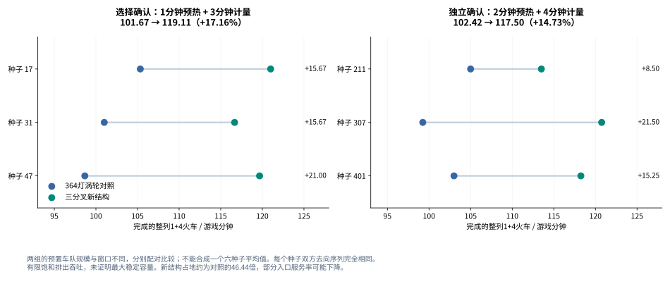
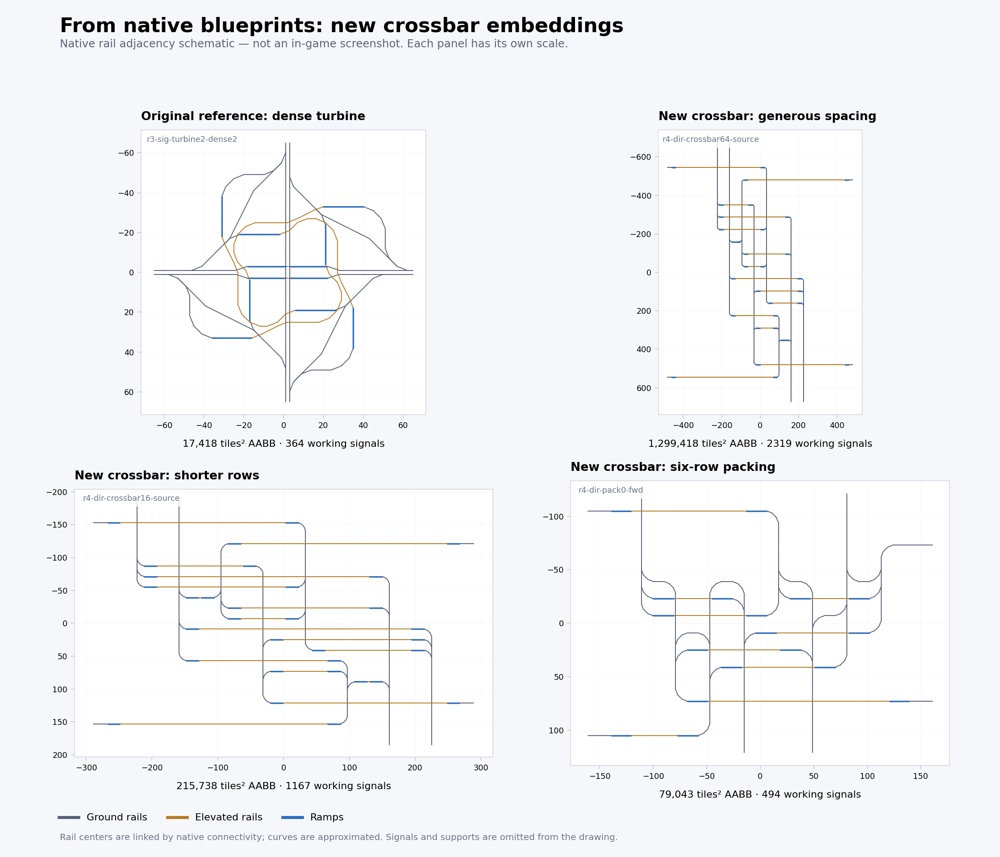
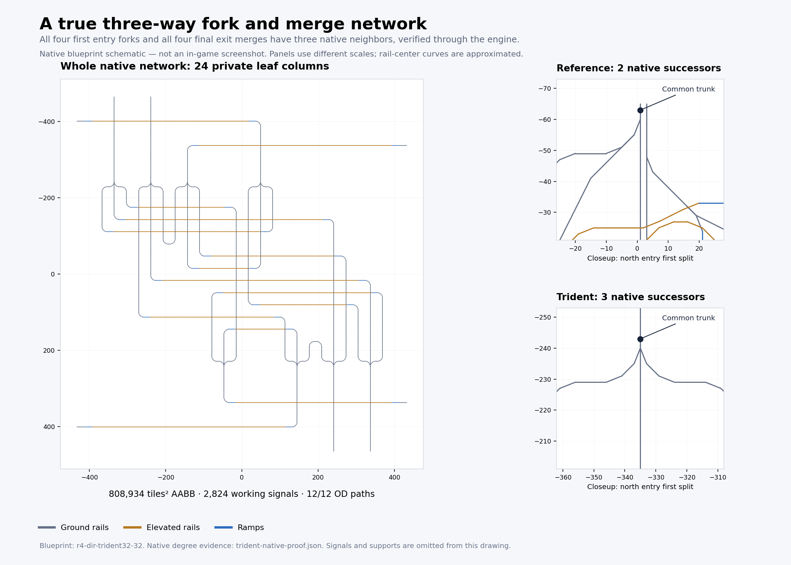
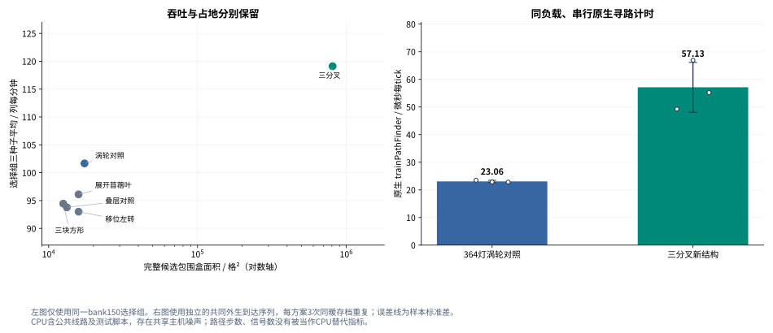

# 铁路研究第四轮：跨构型搜索与原生实测

## 1. 本轮得到的结果

**找到了一种超出原四张蓝图的新结构，并在独立确认组中提高了饱和总排出吞吐。** 它由原生三分叉入口、12条私有OD连接和三路汇合出口组成。在未参与选择的种子211/307/401、每入口240列、预热2分钟/计量4分钟下，三分叉候选平均 **117.50列/游戏分钟**，364灯涡轮对照为 **102.42**，配对增益 **14.73%**，3/3种子更高。

这是一项总吞吐上的新结果，代价明显：占地 **808,934格²**，约为涡轮对照17,418格²的 **46.44倍**；信号2824个，对照364个；同负载原生寻路计时均值为对照的 **2.48倍**。内部穿越延迟和各入口服务差异见下文。它适合作为继续压缩、平衡服务的研究候选，不能直接称为全面更优的成品。



全部结论来自本轮Factorio Headless2.1.25 build88022实测。统计单位为游戏分钟，即60tick/秒；运行墙钟时间不是吞吐单位。完整逐车输入、输出、失败尝试、源脚本及哈希都在研究包中。

## 2. 问题约束与优化目标

四方向各一条单向进线、一条单向出线，固定8个外部端口；右行制；1机车+4空货厢，普通品质、核燃料，制动研究1–7。主比较有12种非掉头OD，每入口近转、直行、远转概率各1/3。每入口保留物理FIFO队列，不能跳过被阻列车、删除未完成需求、改写车速或瞬移。

内部允许增加支线、提前分流、独占缓冲、改变分合流关系，并使用游戏实际支持的地面/高架铁路、普通信号、连锁信号和原生电路。原四张蓝图、原占地框和原轨距都不作为搜索边界。任何为候选增加的接线、坡道、缓冲和控制设施均计入候选占地；所有方案共用的测试站线另行排除。

目标按“可建造/可达/正常信号与碰撞检查 → 吞吐 → 面积和原生CPU代价”比较，不把每平方米吞吐设为首要目标。每个入口和OD的服务也单独列出；一个高总数不足以证明均衡承载能力或避免饥饿。主面积指标为所有原生实体方向变换后主、次包围盒的总包围矩形，并包含高架投影；它不是实际铺轨地面的像素面积。

## 3. 本轮实际探索了什么

截至归档，索引有 **136次完成的原生流量实验**，覆盖 **95种新实体配置**、**54种不同轨道/坡道/支撑几何**。配置计数排除标签、实体编号和整体平移；几何计数另外排除信号及电路/供电设施。这些不是抽象图同构类数量，更不是同等数量的全新拓扑家族。静态建造检查、独立OD通行、时钟烟雾检查和CPU重复另列，不冒充新增构型。

| 路线 | 实际变化 | 本轮发现 |
| --- | --- | --- |
| 从零生成的二分交叉连接网 | 源/目的/交错/直行优先顺序、纵横间距、6行打包、与旧图相同分合流顺序的控制；17个几何布局 | 少数短测高，但代表性较长测试的提升很小，面积大幅增加 |
| 原生三分叉连接网 | 每个入口第一个岔口直接3路分离，每个出口最后一步3路合流；12OD各有私有连接 | 新种子长窗口确认总吞吐增加；巨大面积、延迟与方向不均衡仍待解决 |
| 环形、直行/近转旁路及私有象限 | 从共享环逐步移除不必要环段，改为4个独立远转象限，改变直行层级与尾部长度 | 26种合法几何、14种建造拒绝；31个短流量配置，最优短测113，两个代表长测未超过对照 |
| 独立社区构型 | Celtic、Twister、Windmill、Pinwheel、展开苜蓿叶、Paperclip、移位左转、Cube、三块方形、平面/换层交叉等14个几何来源 | 引入了原四图之外的设计；部分外形不同却有相同的抽象共享关系 |
| 新几何上的信号组合 | 10个社区几何上共30种d2/d4/d8信号打包配置；每次通过原生可放置/working/12OD检查 | 信号越密并不总是越快；短测109的移位左转d4未在长测中保持优势 |
| 原生电路批次放行 | 同H64几何，15秒或30秒每相位，真实算术时钟和供电；同窗口不控制对照 | 两种固定配时均为72.67列/分钟，见配对表；不能推广为所有自适应控制都无效 |

二分交叉网还离线枚举了40,320种列排列，保留32个最少6行的排列解，只实际构造其中8个打包布局。40,320是组合搜索数，绝不计作原生实机测试数。



## 4. 新结构为什么值得研究

原生rail-end邻接审计显示：涡轮对照的4个第一分岔、4个最后合流，在同一轨端的后继（入口）或前驱（出口）轨道数均为2；三分叉候选的这8个位置均为3，三个OD实际使用不同的邻接轨道。这证明它改变了连接结构，而不仅是把原蓝图拉大或移动高度；该数值不是整个岔口的总度数。

候选把流量分离成12条专用OD路线；跨越通过两层铁路实现，最后才按出口汇合。原生选定路线中，42对“起点不同且终点不同”的OD组合没有共享轨道或共享区块；选定路径的区块依赖并集为有向无环图。**旧涡轮对照已经满足前一项0共享性质**，所以不能把“消除独立OD交叉”当作相对旧图的新优势。也不能把有限选路审计当作所有重寻路状态下无死锁的数学证明。

三分叉让三个目的地在同一轨端分开，取消了二级分流之间仅由两个目的地共用的中间段，并改变了出口竞争方式；私有支路也提供缓冲。不过新图分流前公共入口段实际更长：N/E/S/W的共用轨实体数从对照2/1/2/3变为112/313/112/346。这些是实体步数而非距离，不能据此声称总共享长度减少，或相对旧图已经更早分流。当前几何、缓冲、信号同时变化，尚无单因素因果结论。单条外部进线上的队首阻塞仍然存在，只有进入分流点之后的列车才有机会相互独立等待。



以上是根据原生邻接和蓝图坐标绘制的结构示意，曲线以轨道中心连接近似；不是游戏截图。图中省略信号和支撑，整图与局部比例不同。

## 5. 同协议三种子选择确认

每入口150列，静止预置车队间隔40格；预热3600tick，计量10800tick；种子17/31/47。全部18例均有12OD完成、无损伤、四入口在计量期一直有尚未进入的排队列车。下表不混入短测或较长留出组。

| 方案 | 种子17 / 31 / 47 | 平均列/分钟 | 完整占地格² | 信号数 |
| --- | --- | --- | --- | --- |
| 三分叉私有连接网 | 121.00 / 116.67 / 119.67 | 119.11 | 808,934 | 2824 |
| 涡轮二型·364灯对照 | 105.33 / 101.00 / 98.67 | 101.67 | 17,418 | 364 |
| 部分展开苜蓿叶·d4 | 92.67 / 96.00 / 99.67 | 96.11 | 15,881 | 152 |
| 三块方形·d4 | 93.00 / 95.33 / 95.00 | 94.44 | 12,539 | 160 |
| 叠层苜蓿叶·169灯对照 | 91.67 / 97.67 / 92.00 | 93.78 | 13,264 | 169 |
| 交叉移位左转·d4 | 92.67 / 95.33 / 91.00 | 93.00 | 15,892 | 148 |

这一阶段三分叉相对涡轮平均增加17.44列/分钟，即17.16%。它是筛选过程中的结果；最终主要判断应看下一节未参与选择的种子。三块方形等小布局可以作为面积维度的候选，但没有独立确认、出口恢复和同批CPU证据，不列为本轮替换建议。

独立私有象限的短尾版本，短测113；正式seed17长窗101.33，对照105.33。长尾版本102.33。短、长尾分别在计量窗进入306/304列、完成304/307列；内部库存33→35及39→36，完成数差异受库存边界影响，不能据此宣称长尾稳态容量更高。

## 6. 新种子、更长窗口的独立确认

冻结计划在运行前保存于holdout-plan.json，蓝图哈希和协议源哈希逐例核对。每入口240列，预热7200tick，计量14400tick；新种子211/307/401。较大的预置车队避免长观察中源头耗尽，较长预热用于降低巨大布局的起步影响。由于预置车队规模改变了后续入口的伪随机序列，必须连同旧对照一起重跑，不能把此组和上一节混成一个均值。

| 留出种子 | 涡轮对照 | 三分叉 | 增加列/分钟 | 相对增加 |
| --- | --- | --- | --- | --- |
| 211 | 105.00 | 113.50 | 8.50 | 8.10% |
| 307 | 99.25 | 120.75 | 21.50 | 21.66% |
| 401 | 103.00 | 118.25 | 15.25 | 14.81% |
| 均值 | 102.42 | 117.50 | 15.08 | 14.73% |

六例逐车验证了同种子双方OD序列完全相同、入口FIFO顺序保持、损伤0、全部12OD完成、四入口全窗预置车队非空。三次配对不足以宣称总体统计定律；也没有用挑选出的30秒高峰窗口代替预先约定的完整4分钟计量窗。

## 7. 总数之外：方向服务、延迟和内部积车

新结构的总完成数更高，并不意味着每个方向都更好。以下是留出组三次每入口完成率的平均，单位为列/游戏分钟。

| 入口 | 涡轮对照平均列/分钟 | 三分叉平均列/分钟 | 变化 |
| --- | --- | --- | --- |
| N | 26.08 | 33.17 | +7.08 |
| E | 24.00 | 24.00 | +0.00 |
| S | 25.08 | 35.50 | +10.42 |
| W | 27.25 | 24.83 | -2.42 |

若目标是“每个方向持续均匀发车的稳定承载量”，应另外约束每入口队列增长、积压年龄和最低服务率。这里的有限预置车队测试不会丢弃排队需求，但不能凭总完成数推算可长期支撑的均匀外生到达率。当前没有事后挑一个公平阈值来改变排名；完整方向数据供下一轮预先设定约束。

| 方案/种子 | 测窗进入 / 完成 | 内部未完成：起点→终点 | 已完成车平均穿越秒 | 该次P95秒 |
| --- | --- | --- | --- | --- |
| 涡轮 / 211 | 412 / 420 | 27 → 19 | 13.32 | 31.98 |
| 涡轮 / 307 | 391 / 397 | 26 → 20 | 13.90 | 35.18 |
| 涡轮 / 401 | 411 / 412 | 23 → 22 | 13.62 | 31.55 |
| 三分叉 / 211 | 451 / 454 | 92 → 89 | 45.02 | 141.60 |
| 三分叉 / 307 | 490 / 483 | 94 → 101 | 48.52 | 86.95 |
| 三分叉 / 401 | 471 / 473 | 96 → 94 | 45.10 | 74.43 |

逐例满足“进入数−完成数=终点内部未完成数−起点内部未完成数”。穿越时间从入口测量面开始，到所有车厢中心越过出口测量面并满足车身余量结束；只统计计量窗完成的车。仍滞留车不会进入已完成车P95，故同时保存其记录、各OD服务间隔和内部库存。所有1分钟分箱也在JSON中，不能仅用最高分箱宣称容量。

## 8. 面积与原生CPU



在其他Headless任务全部停止后，以同一S1外生到达序列、名义48列/分钟、seed17，先运行7200tick形成暖存档，再计时7200tick；每方案3次相同暖存档重复。逐次完成记录必须完全相同，原生verbose计时总量与引擎报告尺度核对。单位为微秒/tick。

| 计时范围 | 涡轮：均值±样本SD | 三分叉：均值±样本SD | 三分叉/涡轮 |
| --- | --- | --- | --- |
| trainPathFinder | 23.063 ± 0.378 | 57.129 ± 8.998 | 2.48× |
| trains | 106.464 ± 1.076 | 248.124 ± 30.183 | 2.33× |
| scriptUpdate | 67.469 ± 1.078 | 139.723 ± 15.621 | 2.07× |
| wholeUpdate | 417.867 ± 22.166 | 747.522 ± 125.620 | 1.79× |

这组CPU测的是同一较低外生需求下整个测试地图的原生开销，包含公共站线和观察脚本。两分钟计量期双方实际收到114个请求，随机样本到达率为57.0列/分钟；对照完成111列，新方案完成114列。平均地图活动列车分别为17.26与33.90，不能把CPU差异全部归因于寻路图本身。大布局更多在途车和更长路径属于该场景的真实代价；没有将信号数、静态路径步数或并行运行墙钟当作CPU。计时范围可能嵌套，不能把trainPathFinder与trains相加。3次重复反映硬件时间波动，不能代替独立需求种子，也不能直接与前轮不同批次微秒数作因果比较。

额外容量校准中，涡轮对照同夹具仅直行140、仅近转144、仅远转129列/分钟；直行公共出口间距由8改为4/2时分别为138/136。它们只是该几何和夹具的原生参照，不是所有交叉口的物理容量上界，也不支持“出口间距再缩小必然提高本轮上限”。

## 9. 出口堵塞、排空和队首阻塞

W出口配对使用相同seed17、每入口80列：开放对照与第3600–7200tick关闭W第一出口信号的处理组。双方都保留全部320个请求；释放后继续观察到21600tick。两种布局均执行开放/关闭，避免把不同去向序列造成的波动误判为阻塞传播。

| 方案 | W关闭 | 总完成/请求 | 已退场 | 最终仍在地图 |
| --- | --- | --- | --- | --- |
| 涡轮 | False | 320/320 | 320 | 0 |
| 涡轮 | True | 320/320 | 320 | 0 |
| 三分叉 | False | 320/320 | 320 | 0 |
| 三分叉 | True | 320/320 | 320 | 0 |

三分叉还进行了4个出口同时关闭60秒的恢复验收，确认4个不同首出口信号、8次关闭/恢复命令及实际原生状态采样。结果320/320列完成、320列退场，最终地图活动车数0，损伤0。全部预置320列完成并退场是一次有限恢复验收，不能证明任意未来流量下无死锁。

共享入口仍可能因为队首目的出口受阻而阻塞其他目的地。下表使用两种布局完全相同的、所有目的地不是W的请求ID，逐车比较“关闭处理完成时刻−开放对照完成时刻”；包括关闭前已完成的零影响车，负差不截断。它描述整个既定工作负载的外溢延迟，不等于稳态吞吐损失。

| 方案 | 同一开放终点请求数 | 平均增加完成时间秒 | P95增加秒 | 负/零/正差列数 |
| --- | --- | --- | --- | --- |
| 涡轮 | 242 | 17.07 | 71.13 | 42 / 99 / 101 |
| 三分叉 | 242 | 0.00 | 0.00 | 0 / 242 / 0 |

外部120格范围内的队首停车代理只覆盖入口局部，不等于全路口HOL总时间；大布局也可能只是把等待移到了其内部。本例有更强证据：三分叉的242列开放终点请求，在开放与W关闭两种条件下，入口、完成、退场三个时刻均逐车完全一致；关闭期间开放终点交付93→93，对照为79→51。因此本例确实隔离了对开放终点的影响。但最后一列退场时间的追加延迟，对照为32.27秒，新图为33.23秒，不能说新图整批排空更快。关闭阶段服务、恢复服务、所有逐车事件与关闭前轨迹一致性，见external/hol-comparison.json及external/HOL.zh-CN.md。

## 10. 固定电路放行没有带来提升

同一H64交叉连接网，保持原轨道与原信号坐标不变，在每条私有OD的独占出口门上添加原生控制。使用真实太阳能、蓄电池、电线和算术组合器，未通过Lua每tick切灯或改写能量。3个相位轮流放行兼容的4条OD，每相位15秒或30秒；共同bank240、预热90秒、计量180秒、seed17。

| 原生控制策略 | 同窗完成列数 | 列/分钟 | 全部12OD |
| --- | --- | --- | --- |
| 15秒/相位 | 218 | 72.67 | True |
| 30秒/相位 | 218 | 72.67 | True |
| 同几何不控制 | 327 | 109.00 | True |

时钟相位实际绿窗900/1800tick，P信号首次计算有2tick延迟、实体灯再滞后1tick，启动瞬间与稳定测量期分开记录。测量期电量及工作状态正常；电路关门时仍有原生黄灯已预约车辆，实验保留游戏行为，不强制取消。两种固定配时的218列相同但逐车轨迹不同，不是重复输入或相同结果缓存。

一部分OD私有缓冲约80.4格，另一些超过650格；固定长红灯可能让短支路更早回堵入口。这是结合路径与观察的解释，还不是单因素证明。未控制的H64本身也有方向不均衡，因此不能把N/S与E/W的全部差异归因于电路。未来可研究按实际队列和饥饿时间自适应放行，但当前负结果不能包装为成功方案。

## 11. 原生校验、修复与来源

新增所有主要比较候选使用普通可建造规则，不以绕过碰撞的实体创建作为通过条件；蓝图全实体复活、信号working、12OD原生路径和实际1+4流量均有证据。不同构造路线出现坡道/高架曲线冲突的失败方案被保留。

社区三块方形原输入有1个未连接轨道的信号，原生坐标(44.5,4.5)、方向11。清理版本仅删去该无效灯；相同短测的320列逐车记录与采样全部一致，工作信号校验通过。原输入的失败灯状态和原测试记录均保留，没有把清理后的文件覆盖成历史输入。部分社区图还需要地面端口适配、8格接线或高架端口落地，全部新增几何计入占地。

社区固定来源、作者、上游标签、获取地址与SHA256见external/source-catalog.json。主要来源为Opinionated-Blueprints/10-Books-Full-of-Rails，以及DaveMcW的Cube和mmmPI的三块方形原帖。公共仓库发布来源清单、校验值、获取脚本和实验汇总；未明确许可的第三方蓝图全文不复制到公共仓库。私有完整证据包保存实际测试输入，便于核对。

原生高架机制参考：[Factorio官方FFF-378](https://factorio.com/blog/post/fff-378)。原生路径查询接口参考：[LuaTrainManager](https://lua-api.factorio.com/latest/classes/LuaTrainManager.html)。外部蓝图来源：[10 Books Full of Rails](https://github.com/Opinionated-Blueprints/10-Books-Full-of-Rails)。本报告数值来自本实验，不引用社区排行分数代替实测。

## 12. 下一轮最有价值的方向

第一，压缩三分叉结构。忽略曲线和储车段，将4个输入叉与4个输出汇作为顶点、12个非同名OD作为边，核心的无向底图为K4,4去掉4条同名边，与立方体图同构。可以用“内外两个四边形加4条连接边”作为紧凑嵌入种子，再用高架解决固定外端口接线。这个数学结构只说明值得尝试；固定8端口顺序、三叉切线、原生曲线、坡道与整列等待空间仍需原生求解。当前没有生成或测试该紧凑版本，不计入成果；它与本轮已经引入并测试的社区DaveMcW Cube蓝图是不同对象。

第二，在尽量相同的几何和储车空间上做入口二分/三分、出口二合/三合的2×2消融，并测试整图旋转，以区分本轮增益中的分合流关系、路径长短和方向优先效应。第三，围绕每入口最低服务、长期队列增长和最老请求等待时间优化，避免总吞吐增长伴随某个入口退步；自适应电路必须保持原生供电与预约行为。

均匀S1之外的直行70%/近转70%/远转70%、满载车厢和其他编组尚未完成本轮独立确认，列为下一阶段。搜索目标继续是吞吐优先、面积/CPU代价透明，并先通过连接、信号、全OD服务与恢复门槛。

## 13. 可导入蓝图与完整复现

- junctions-round4.txt：三项蓝图册，顺序为大型三分叉研究候选、364灯涡轮对照、169灯叠层对照。
- trident-research.txt：与原生实测输入逐字节相同的新结构单图。
- blueprint-manifest.json：蓝图册只更改叶子名称，全部实体、电路连线及其他蓝图字段保持一致。
- book-validation.json：2.1.25原生导入成功，共3项、10033个实体；实体内容另由导出前后精确比较验证。
- results-summary.json：主要配对数据、方向服务、库存、原生CPU与恢复摘要。完整输入、原生记录、日志、被拒绝的候选、生成器及运行脚本在研究包中。

将固定引擎及对应游戏数据放到研究根目录engine/factorio，启用base/quality/elevated-rails/space-age。研究包不再分发引擎与游戏资产。已有相同case hash的完成结果会被缓存复用；若要独立重跑，在新工作目录保留证据副本，并将对应experiments输出移到归档目录后再运行。CPU profiles中的原存档路径为原环境绝对路径；跨目录重跑CPU时同样使用新的profiles目录重新准备暖存档。

```bash
python3 round4/run_holdout.py --ids r3-sig-turbine2-dense2 --output round4/holdout-reference.json
python3 round4/run_holdout.py --ids r4-dir-trident32-32 --output round4/holdout-trident.json
python3 round4/blockage/run.py --ids r3-sig-turbine2-dense2 r4-dir-trident32-32 --seeds 17 --output round4/hol-paired.json
python3 round4/blockage-all/run.py --ids r4-dir-trident32-32 --seeds 17 --output round4/all-exits-drain.json
python3 round4/cpu/run.py --ids r3-sig-turbine2-dense2 r4-dir-trident32-32 --rate 48 --seed 17 --warmup 7200 --ticks 7200 --runs 3 --timeout 900
python3 round4/index_results.py
python3 round4/analyze_final.py --require-complete
python3 round4/build_report.py
```

本轮归档不宣称全局最优、最大稳定容量、任意需求无死锁、全部方向改善或高峰负载下CPU等同比例。旧四图已成为对照；本轮新增连接结构、外部独立来源、失败结果和原生证据共同构成下一轮可复用的搜索基础。
